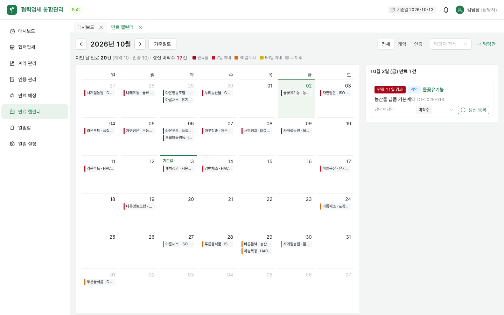
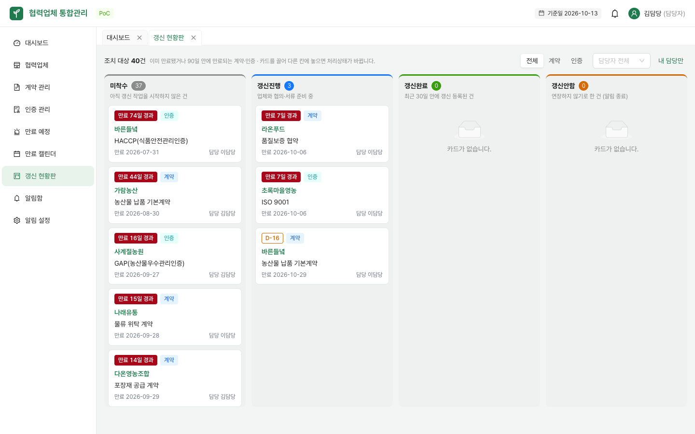

# 협력업체 통합관리 사용 설명서

- 작성자: JinsuBae2
- 최종 수정일: 2026-10-13
- 대상: 시연 프로토타입(dev 환경). 화면의 업체·계약·인증은 모두 가상의 샘플 데이터다.

이 문서는 메뉴마다 **어떤 일을 하는 화면인지**, **어떻게 쓰는지**, **알아두면 좋은 규칙**을 스크린샷과 함께 설명한다. 실행 방법과 5분 시연 순서는 [README](../README.md)를 먼저 본다.

## 목차

1. [시작하기: 계정과 역할](#1-시작하기-계정과-역할)
2. [화면 공통 구성](#2-화면-공통-구성)
3. [대시보드](#3-대시보드)
4. [협력업체](#4-협력업체)
5. [계약 관리](#5-계약-관리)
6. [인증 관리](#6-인증-관리)
7. [만료 예정](#7-만료-예정) · [만료 캘린더](#71-만료-캘린더) · [갱신 현황판](#72-갱신-현황판)
8. [알림함](#8-알림함)
9. [알림 설정 (관리자)](#9-알림-설정-관리자)
10. [개발용 메일함 (Mailpit)](#10-개발용-메일함-mailpit)
11. [시연 시나리오와 화면 흐름](#11-시연-시나리오와-화면-흐름)
12. [스크린샷 다시 찍기](#12-스크린샷-다시-찍기)

---

## 1. 시작하기: 계정과 역할


http://localhost:5173 에 접속하면 로그인 화면이 나온다. 시연 계정의 비밀번호는 모두 같고 `.env.example`의 `SEED_PASSWORD` 값이다.

| 아이디 | 이름 | 역할 | 할 수 있는 일 |
|---|---|---|---|
| `admin` | 관리자 | 관리자 | 모든 조회·등록·수정 + 알림 기준 변경, 발송 이력, 시연 도구(기준일 변경·즉시 점검) |
| `manager1` | 김담당 | 담당자 | 조회, 업체·계약·인증 등록·수정·갱신, 내 알림 처리 |
| `manager2` | 이담당 | 담당자 | 위와 같음 (담당 업체가 다름) |
| `viewer` | 박조회 | 조회자 | 조회와 엑셀 다운로드만. 등록·수정 버튼이 화면에 보이지 않는다 |

- 로그인에 실패하면 안내 문구가 나오고 비밀번호 칸이 비워진다.
- 새로고침해도 로그인이 유지되며, 오래 쓰지 않아 세션이 끊기면 자동으로 로그인 화면으로 돌아간다.
- 권한은 화면(버튼 숨김)과 서버 양쪽에서 제한한다. 조회자가 주소를 직접 호출해도 서버가 막는다.

## 2. 화면 공통 구성

로그인 후 모든 화면은 같은 틀을 쓴다. ERP에서 익숙한 "좌측 메뉴 + 상단 작업 탭 + 검색조건 → 그리드" 구조다.

| 위치 | 구성 | 설명 |
|---|---|---|
| 상단 왼쪽 | 시스템 이름 | |
| 상단 오른쪽 | **기준일** 태그 | 모든 D-day와 만료 판정의 기준 날짜. 시연용으로 날짜를 옮기면 주황색 "시연 기준일"로 바뀐다 ([9장](#91-시연용-기준일-변경)) |
| 상단 오른쪽 | **🔔 알림** | 미확인 알림 수 배지. 누르면 최근 5건 미리보기 ([8장](#8-알림함)) |
| 상단 오른쪽 | 사용자 이름(역할) | 누르면 로그아웃 |
| 좌측 | 메뉴 | 창 폭이 1200px보다 좁으면 아이콘만 남기고 접힌다 |
| 본문 위 | **작업 탭** | 메뉴나 링크로 연 화면이 탭으로 쌓인다. 탭을 눌러 오가고 ✕로 닫는다. 업체 상세는 업체명이 탭 이름이 된다 |

**모든 목록 화면의 공통 사용법**

- 검색조건 입력 후 **Enter** 또는 [조회]로 조회하고, [초기화]로 조건을 비운다.
- 마지막 검색조건은 브라우저에 저장되어 탭을 옮기거나 새로고침해도 유지된다.
- 그리드 머리글을 누르면 정렬, 경계선을 끌면 폭이 바뀐다. 아래쪽에서 페이지 크기(20·50·100)를 고른다.
- [엑셀 다운로드]는 **현재 조회한 조건** 그대로 xlsx 파일을 내려받는다.
- 등록·수정 창에서 **Ctrl(⌘)+S**로 저장할 수 있다. 필수 칸은 `*`로 표시되고, 잘못 입력하면 해당 칸 아래에 이유가 나온다.

**D-day 배지 읽는 법** (모든 화면 공통)

| 배지 | 뜻 |
|---|---|
| <kbd>만료 N일 경과</kbd> (진한 빨강, 채움) | 이미 만료됨. 즉시 확인 |
| <kbd>D-DAY</kbd> · <kbd>D-1</kbd>~<kbd>D-7</kbd> (빨강, 채움) | 7일 이내 만료 |
| <kbd>D-8</kbd>~<kbd>D-30</kbd> (주황 테두리) | 30일 이내 만료 |
| <kbd>D-31</kbd>~<kbd>D-90</kbd> (노랑 테두리) | 90일 이내 만료 |
| <kbd>D-91</kbd> 이상 (회색) | 정상 |
| <kbd>무기한</kbd> | 종료일이 없는 계약 |
| <kbd>확인 필요</kbd> (보라) | 만료일이 등록되지 않은 인증 |

색만으로 구분하지 않도록 배지에는 항상 글자가 함께 나온다.

## 3. 대시보드


**하는 일**: 로그인하면 처음 보는 화면. "오늘 무엇을 처리해야 하는지"를 위에서 아래로 보여준다.

| 영역 | 내용 | 누르면 |
|---|---|---|
| 인사말 | 기준일과 **내 담당 중 조치가 필요한 건수** | 내 담당 만료 예정 목록 |
| 현황 카드 4개 | 협력업체 수(거래중), 유효 계약, 유효 인증, 내 담당 조치 대상 | 각 목록 화면 |
| 만료 현황 | 만료됨 · 7일 이내 · 30일 이내 · 90일 이내 · 확인 필요 건수, 갱신 진행률 | 해당 구간의 만료 예정 목록 |
| 가장 급한 항목 | 만료 → D-DAY → D-1 … 순으로 10건 | 업체명을 누르면 업체 상세 |

- "조치 대상"은 이미 만료됐거나 90일 안에 만료되는 유효 계약·인증이다.
- 30일 이내 숫자에는 7일 이내가, 90일 이내 숫자에는 30일 이내가 포함된다.
- 카드의 숫자는 만료 예정 목록과 같은 조회로 계산하므로 항상 일치한다.

## 4. 협력업체

### 4.1 협력업체 목록


**하는 일**: 협력업체를 찾고, 업체별로 계약·인증이 몇 건이고 **만료가 임박한 건이 몇 건인지** 한눈에 본다.

1. 업체명 또는 업체코드(예: `SUP-0001`), 거래상태, 보유 인증(예: HACCP 보유 업체만)으로 조회한다.
2. **행을 더블클릭**하거나 업체명을 누르면 업체 상세가 새 탭으로 열린다.
3. [업체 등록]으로 새 업체를 등록한다. (조회자에게는 버튼이 없다)

- "계약"·"인증"은 현재 유효한 건수이고, 갱신되어 이력이 된 건은 세지 않는다.
- "만료·임박"은 이미 만료됐거나 90일 안에 만료되는 건수이며, 1건 이상이면 빨간 숫자로 표시된다.

### 4.2 협력업체 등록·수정


| 칸 | 규칙 |
|---|---|
| 업체명 `*` | 필수 |
| 거래상태 `*` | 거래중 · 거래중지 · 거래종료. **거래중이 아닌 업체는 만료 알림을 보내지 않는다** |
| 사업자번호 | 숫자만 치면 `000-00-00000` 형식으로 하이픈이 자동으로 들어간다 |
| 내부 담당자 | 이 업체를 맡는 우리 회사 담당자. 계약·인증을 등록할 때 담당자를 비워두면 이 사람이 자동 지정된다 |
| 업체 담당자·연락처·이메일 | 업체 측 연락처. 이메일은 형식을 검사한다 |

- 업체코드는 저장할 때 `SUP-0001` 형식으로 자동 발급된다.
- 필수 칸을 비우고 저장하면 위 그림처럼 칸 아래에 이유가 나오고 저장되지 않는다.

### 4.3 협력업체 상세


**하는 일**: 한 업체의 기본정보·계약·인증을 한 화면에서 본다. 흩어진 자료를 업체 단위로 모으는 것이 이 시스템의 핵심이다.

| 영역 | 내용 |
|---|---|
| 상단 요약 | 업체명·거래상태·업체코드·내부 담당자, 유효 계약·유효 인증·만료임박(90일) 건수, [기본정보 수정] |
| 기본정보 탭 | 업체 정보 전체와 등록자·등록일시·최종 수정자·수정일시 |
| 계약 탭 | **이 업체의 계약만** 보인다. [계약 등록]을 누르면 업체가 미리 선택된 상태로 등록 창이 열린다 |
| 인증 탭 | 이 업체의 인증만 보인다. [인증 등록]도 같은 방식 |

- 계약·인증 탭의 그리드는 [계약 관리](#5-계약-관리)·[인증 관리](#6-인증-관리) 화면과 같아서 처리상태 변경, 수정, 갱신을 여기서 바로 할 수 있다.
- "이전 이력 포함"을 켜면 갱신되어 이력이 된 계약·인증도 흐린 글씨와 <kbd>이전</kbd> 표시로 함께 보인다.

## 5. 계약 관리

### 5.1 계약 목록


**하는 일**: 전체 업체의 계약을 **종료일이 가까운 순**으로 보고, 갱신 처리상태를 관리한다.

1. 검색어(계약명·계약번호·업체명), 담당자, 처리상태로 조회한다. [내 담당만]을 누르면 내가 맡은 계약만 남는다.
2. **갱신 처리** 칸에서 목록을 벗어나지 않고 처리상태를 바로 바꾼다.
3. 행의 [수정] 또는 행 더블클릭으로 계약 정보를 고친다.
4. 행의 [갱신]으로 새 계약을 등록한다. (5.2)

| 갱신 처리상태 | 뜻 |
|---|---|
| 미착수 | 아직 갱신 작업을 시작하지 않음 |
| 갱신진행 | 업체와 협의 중 등 진행 중 |
| 갱신완료 | [갱신]으로 새 계약을 등록하면 이전 계약이 자동으로 이 상태가 된다. 목록에서 직접 고를 수는 없다 |
| 갱신안함 | 계약을 연장하지 않기로 함. 이 상태가 되면 해당 계약의 알림이 자동으로 완료 처리된다 |

- 종료일을 비워두면 **무기한 계약**이 되며 만료 판정·알림 대상이 아니다.
- 종료일이 시작일보다 빠르면 저장되지 않는다.
- 같은 업체에 같은 계약번호가 있으면 **저장은 되지만 경고**가 뜬다(번호를 다시 확인하라는 뜻).
- 계약서 위치에 공유폴더·문서함 링크를 넣으면 계약명 옆에 🔗 아이콘이 생기고 누르면 열린다.

### 5.2 계약 갱신


**하는 일**: 만료가 다가온 계약을 새 계약으로 이어서 등록한다.

1. 기존 계약 행의 [갱신]을 누른다. (만료 예정 목록의 [갱신 등록]도 같은 창이 열린다)
2. 창에는 기존 내용이 채워져 있고, **시작일은 기존 종료일 다음날, 종료일은 그로부터 1년**으로 미리 들어간다.
3. 새 계약번호만 입력하고(필요하면 기간·담당자도 수정) 저장한다.

저장하면 다음이 한 번에 처리된다.

- 새 계약이 등록되고 이전 계약과 연결된다.
- 이전 계약은 "갱신완료" 상태의 **이력**이 되어 기본 목록에서 빠진다("이전 이력 포함"으로 볼 수 있음).
- 이전 계약에 대해 와 있던 **알림이 모두 자동으로 "완료"** 된다.

기존 행을 고치지 않고 새 행을 만드는 방식이라 과거 계약 기간과 문서가 그대로 남는다. 이미 갱신된 계약은 다시 갱신할 수 없다.

## 6. 인증 관리


**하는 일**: 업체별 인증(HACCP, GAP, 유기농산물 등)을 **만료일이 가까운 순**으로 보고 갱신을 관리한다. 사용법은 [계약 관리](#5-계약-관리)와 같고, 다른 점만 적는다.

- 인증 종류로 조회할 수 있다. 인증 종류 목록은 예시값이며 실제 관리 대상은 미팅에서 확정한다.
- 만료일을 비워두면 무기한이 아니라 <kbd>확인 필요</kbd>로 분류된다. 만료일이 없는 인증은 드물기 때문에 입력 누락일 가능성이 크다고 본다.
- 만료일이 발급일보다 빠르면 저장되지 않는다.
- 같은 인증 종류·인증번호가 이미 있으면 저장은 되지만 경고가 뜬다.
- [갱신]을 누르면 업체·인증 종류는 그대로 두고, 인증번호·발급일(오늘로 제안)·만료일을 새로 입력한다.

## 7. 만료 예정


**하는 일**: 계약과 인증을 **한 목록에 합쳐 급한 순으로** 보고, 여기서 바로 처리한다. 담당자가 매일 확인하는 작업 목록이다.

1. 위쪽 **기간 칩**에서 구간을 고른다. 칩 옆 숫자가 건수다.

   | 칩 | 포함 범위 |
   |---|---|
   | 만료됨 | 이미 만료일이 지난 유효 계약·인증 |
   | 7일 이내 | 오늘(D-DAY)부터 7일 안에 만료 |
   | 30일 이내 | 오늘부터 30일 안에 만료 (7일 이내 포함) |
   | 90일 이내 | 오늘부터 90일 안에 만료 (30일 이내 포함) |
   | 확인 필요 | 만료일이 등록되지 않은 인증 |

2. 유형(전체·계약·인증), 담당자, 처리상태로 더 좁힌다. [내 담당만]으로 내 것만 본다.
3. **갱신 처리** 칸에서 "갱신진행" 등으로 바로 바꾼다.
4. [갱신 등록]을 누르면 원본 계약·인증을 불러와 [갱신 창](#52-계약-갱신)이 열린다. 저장하면 이 목록에서 빠진다.

- 7·30·90일 구간에는 이미 만료된 건이 들어가지 않는다. 만료된 건은 "만료됨"에서 따로 본다.
- 대시보드의 숫자를 누르면 이 화면이 해당 구간으로 열린다.
- 정렬은 남은 일수가 적은 순이고, 같으면 업체명 순이다.

### 7.1 만료 캘린더



**하는 일**: 계약 종료일·인증 만료일을 월 달력에 올려 **만료가 언제 몰려 있는지** 한눈에 본다. 목록이 "무엇이 급한가"를 보여준다면, 캘린더는 "언제 바빠지는가"를 보여준다.

1. 처음 열면 **기준일이 있는 달**이 열리고 기준일 칸에 "기준일"이 표시된다. ‹ › 로 달을 옮기고, [기준일로]로 돌아온다.
2. 날짜 칸에는 그날 만료되는 건이 "업체명 · 대상명"으로 최대 3건 보이고, 더 있으면 "+N건"으로 표시된다. 마우스를 올리면 유형까지 전체 이름이 보인다.
3. **날짜를 누르면** 오른쪽 패널에 그날 만료되는 건이 나온다. 여기서 처리상태를 바꾸거나 [갱신 등록]을 하고, 업체명을 눌러 업체 상세로 간다.
4. 위쪽에서 유형(전체·계약·인증), 담당자, [내 담당만]으로 거른다. 조건은 브라우저에 저장된다.

| 칸 안 왼쪽 색 띠 | 뜻 (D-day 배지와 같은 기준) |
|---|---|
| 진한 빨강 | 이미 만료됨 |
| 빨강 | 7일 이내 |
| 주황 | 30일 이내 |
| 노랑 | 90일 이내 |
| 회색 | 90일 이후 |

- 위쪽 요약 줄은 **이번 달(1일~말일)** 만료 건수를 계약·인증으로 나누어 보여주고, 그중 갱신 처리상태가 "미착수"인 건수를 빨간 숫자로 강조한다.
- 지난 날짜에 남아 있는 건은 갱신하지 않고 만료된 것이다. 갱신을 등록하면 이력이 되어 달력에서 빠진다.
- 무기한 계약과 만료일이 없는 인증은 날짜가 없으므로 달력에 나오지 않는다. 만료 예정 목록의 "확인 필요"에서 본다.
- 창이 좁으면 오른쪽 패널이 달력 아래로 내려간다.

### 7.2 갱신 현황판



**하는 일**: 조치가 필요한 계약·인증을 **갱신 처리상태별 칸**에 카드로 놓고, 카드를 끌어 옮겨 상태를 바꾼다. 누가 어떤 건을 어디까지 진행했는지 팀 전체가 한 화면에서 본다.

| 칸 | 들어가는 카드 |
|---|---|
| 미착수 | 이미 만료됐거나 90일 안에 만료되는데 아직 갱신 작업을 시작하지 않은 건 |
| 갱신진행 | 업체와 협의·서류 준비 중인 건 |
| 갱신완료 | **최근 30일 안에** [갱신]으로 새 계약·인증이 등록된 이전 건 (그보다 오래된 건은 빠진다) |
| 갱신안함 | 연장하지 않기로 한 건. 관련 알림은 자동으로 완료된다 |

1. 카드를 끌어 **미착수·갱신진행·갱신안함** 칸에 놓으면 처리상태가 바로 바뀐다. 끄는 동안 놓을 수 있는 칸이 초록 테두리로 표시된다.
2. 카드를 **갱신완료** 칸에 놓으면 [갱신 창](#52-계약-갱신)이 열린다. 새 계약·인증을 저장해야 완료 칸으로 옮겨지고, 창을 닫으면 그대로 남는다.
3. 칸 안의 카드는 급한 순(만료 → D-DAY → D-1 …)으로 놓인다. 업체명을 누르면 업체 상세로 간다.
4. 위쪽에서 유형(전체·계약·인증), 담당자, [내 담당만]으로 거른다.

- 갱신완료 카드는 이미 이력이 된 건이라 옮길 수 없다. 조회자는 카드를 볼 수만 있다.
- "갱신완료"는 서버에서도 처리상태 변경으로 지정할 수 없고 [갱신] 등록으로만 처리된다. 이미 갱신된 이력 건의 처리상태도 바꿀 수 없다.

## 8. 알림함

### 8.1 실시간 알림


만료 점검(매일 08:00, 또는 관리자의 [만료 점검 지금 실행])으로 내 담당 알림이 생기면 **새로고침하지 않아도** 오른쪽 위에 팝업이 뜨고 🔔 숫자가 바뀐다.

- 한 번에 여러 건이 오면 팝업이 쏟아지지 않게 "새 만료 알림 N건" 하나로 묶는다. 팝업을 누르면 알림함이 열린다.
- 같은 알림이 이메일로도 발송된다([10장](#10-개발용-메일함-mailpit)).

### 8.2 🔔 미리보기


상단 🔔를 누르면 미확인 알림 최근 5건이 보인다. 항목이나 [알림함 전체 보기]를 누르면 알림함으로 간다.

### 8.3 알림함


**하는 일**: 내게 온 만료 알림을 **만료일이 가까운 순**으로 보고 처리상태를 관리한다.

1. 위쪽 탭(미확인 · 확인 · 처리중 · 완료 · 전체)으로 상태별로 본다. 미확인 알림은 노란 배경이다.
2. [업체 보기]를 누르면 해당 업체 상세로 가고, 미확인 알림은 자동으로 "확인"이 된다.
3. 오른쪽 선택상자로 처리상태를 바꾼다. [모두 확인]은 미확인 알림을 한 번에 확인 처리한다.
4. 각 알림 아래의 <kbd>이메일 ✓</kbd> <kbd>화면 ✓</kbd>는 채널별 발송 결과다. 발송이 실패하면 재시도 대기·실패 표시가 나오고, 마우스를 올리면 사유가 보인다.

**알림이 오는 규칙**

- 기본 기준은 만료 **90일·30일·7일 전**이며, 관리자가 [알림 설정](#9-알림-설정-관리자)에서 바꿀 수 있다.
- 남은 일수에 해당하는 **가장 작은 기준 하나**로만 알린다. 예: 20일 남았으면 "30일 전" 알림 1건. 며칠 뒤 7일 이내가 되면 "7일 전" 알림이 새로 온다.
- 같은 대상·같은 기준·같은 만료일 알림은 **두 번 오지 않는다**. 점검을 여러 번 실행해도 마찬가지다.
- 받는 사람은 계약·인증의 내부 담당자이고, 담당자가 없으면 관리자 전원이다.
- 거래중이 아닌 업체, "갱신완료·갱신안함" 처리된 건은 알리지 않는다.
- 계약·인증을 갱신하거나 "갱신안함"으로 바꾸면 관련 알림이 **자동으로 "완료"** 된다.
- 이미 만료된 건은 새로 알리지 않는다. 대시보드와 만료 예정 목록의 "만료됨"에서 확인한다.

## 9. 알림 설정 (관리자)


**하는 일**: 알림 기준을 정하고, 발송이 제대로 되는지 확인한다. 관리자가 아니면 기준을 볼 수만 있다.

| 영역 | 사용법 |
|---|---|
| 알림 기준 | 계약·인증 각각 "만료 며칠 전에 알릴지"를 입력하고(숫자 입력 후 Enter, 0~365일), 채널(화면·이메일)과 사용 여부를 정한 뒤 [저장] |
| 시연 도구 | [만료 점검 지금 실행]: 매일 08:00를 기다리지 않고 바로 점검·발송한다. 결과 창에 새로 만든 알림 수, 중복으로 건너뛴 수, 제외한 수가 나온다. [개발용 메일함 열기]는 Mailpit을 연다 |
| 발송 이력 | 최근 200건의 채널별 발송 결과(수신자, 채널, 상태, 실패 횟수, 발송 시각, 실패 사유). 10초마다 자동으로 새로 고친다 |

- 발송은 10초마다 대기열을 확인해 처리한다. 이메일 발송이 실패하면 30초 · 1분 · 2분 · 4분 간격으로 다시 시도하고, 5번 실패하면 "실패"로 기록한다. 발송이 실패해도 알림 자체는 알림함에 남는다.
- 시연 도구는 dev 환경의 관리자에게만 보인다.

### 9.1 시연용 기준일 변경


관리자가 상단 **기준일** 태그를 누르면 날짜를 옮길 수 있다. 발표 때 "3개월 뒤" 같은 상황을 보여주는 용도다.

1. 날짜를 고르고 [적용]을 누르면 모든 D-day, 만료 판정, 대시보드 숫자가 그 날짜 기준으로 바뀐다. 상단 태그는 주황색 "시연 기준일"이 된다.
2. 이 상태에서 [만료 점검 지금 실행]을 누르면 그날 기준으로 새로 임박한 항목의 알림이 생성된다.
3. [실제 날짜로]를 누르거나 서버를 재시작하면 원래 날짜로 돌아간다.

## 10. 개발용 메일함 (Mailpit)


개발 환경에서는 알림 메일을 실제로 보내지 않고 **Mailpit**(http://localhost:8025)이 받아서 보여준다. 담당자별로 어떤 메일이 갔는지, 제목·본문·링크를 확인할 수 있다.

- 제목: `[협력업체 통합관리] [D-7] 업체명 · 대상명 만료 예정`
- 본문: 만료일, 적용 기준(만료 N일 전), 알림함과 업체 상세로 가는 링크
- 실제 서비스에서는 메일 서버 주소 설정만 사내 SMTP로 바꾸면 된다.

## 11. 시연 시나리오와 화면 흐름

README의 5분 시연 순서를 화면 기준으로 풀면 다음과 같다.

| 순서 | 계정 | 화면 | 보여줄 것 |
|---|---|---|---|
| 1 | manager1 | [대시보드](#3-대시보드) | 오늘 처리할 일: 만료 4 · 7일 이내 9, 가장 급한 항목 |
| 2 | admin (다른 창) | [알림 설정](#9-알림-설정-관리자) | [만료 점검 지금 실행] → 결과 창 |
| 3 | manager1 | [실시간 알림](#81-실시간-알림) | 새로고침 없이 팝업과 🔔 배지 |
| 4 | - | [Mailpit](#10-개발용-메일함-mailpit) | 담당자에게 간 알림 메일 |
| 5 | manager1 | [알림함](#83-알림함) → [업체 상세](#43-협력업체-상세) → [갱신](#52-계약-갱신) | 갱신 등록 후 알림이 자동 "완료" |
| 6 | admin | [기준일 변경](#91-시연용-기준일-변경) → 점검 | 3개월 뒤 새로 임박한 알림 생성 |
| 7 | admin | 알림 설정 | 같은 날짜로 다시 점검하면 새 알림 0건 (중복 방지) |
| 8 | viewer | 계약 관리 | 등록·수정·갱신 버튼이 없는 조회 전용 화면 (아래) |


시연을 처음 상태로 되돌리려면 `docker compose down -v`로 DB를 지우고 다시 띄운다. 샘플 데이터는 **오늘 날짜 기준 상대값**으로 들어가므로 언제 시연해도 D-DAY, D-7, D-30, 만료 같은 사례가 항상 있다.

## 12. 스크린샷 다시 찍기

화면이 바뀌면 스크립트로 이 문서의 스크린샷을 한 번에 다시 찍을 수 있다. 설치된 Google Chrome을 사용한다.

```bash
# 터미널 1: 깨끗한 DB·메일 서버 + 백엔드
docker compose down -v && docker compose up -d
cd backend && ./gradlew bootRun

# 터미널 2: 화면
cd frontend && npm run dev

# 터미널 3: 캡처
cd frontend && npm run capture:guide
```

- 결과는 `docs/images/`에 덮어쓴다.
- 스크립트가 만료 점검을 한 번 실행하므로, 실시간 팝업까지 찍으려면 **알림이 없는 깨끗한 DB**에서 실행해야 한다. 끝난 뒤 다시 `docker compose down -v`로 초기화한다.
- 크롬 위치가 다르면 `CHROME_PATH` 환경변수로 지정한다.
